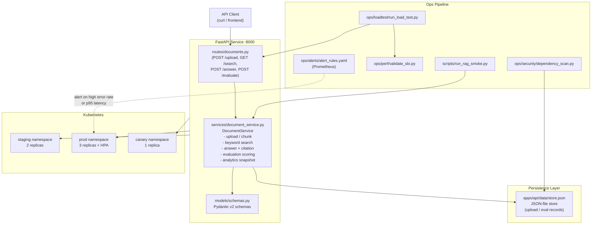
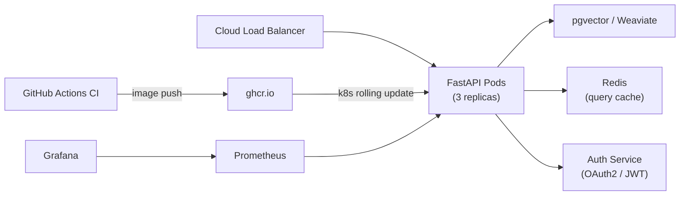

# Architecture — Enterprise RAG Platform

## Overview

The Enterprise RAG (Retrieval-Augmented Generation) Knowledge Platform is a FastAPI service that enables multi-tenant document Q&A. Clients upload documents, which are chunked and indexed in a JSON-backed store. Search and answer endpoints retrieve relevant chunks and synthesise answers with citations.

## Component Diagram



## Data Flow

1. **Upload** — Client POSTs document text → `DocumentService.upload()` → chunks into `DocumentChunk` records → persists to `store.json`
2. **Search** — Client GETs query → keyword scan over chunks → returns `SearchResult` list with scores
3. **Answer** — Client POSTs question → retrieves top chunks → builds `AnswerResponse` with `AnswerCitation` list
4. **Evaluate** — Client POSTs eval request → scores answer quality → stores `EvaluationRecord`
5. **Analytics** — Client GETs snapshot → aggregates query counts, top terms, eval metrics

## Key Design Decisions

| Decision                    | Rationale                                                                        |
| --------------------------- | -------------------------------------------------------------------------------- |
| JSON file store             | Zero-dependency portability; swap for pgvector/Weaviate in prod                  |
| Pydantic v2 schemas         | Full input validation at API boundary; prevents injection via malformed payloads |
| Multi-tenant by `tenant_id` | All store operations filter by tenant; prevents cross-tenant data leakage        |
| Seed demo docs on first run | Enables zero-config demo without a separate data setup step                      |
| Chunking strategy           | Fixed-window chunking simulates real vector-store chunking for demo fidelity     |

## Production Architecture (Target)



## Directory Map

```
enterprise-rag-platform/
├── apps/api/
│   ├── app/
│   │   ├── main.py              # FastAPI app, /health
│   │   ├── routes/documents.py  # HTTP layer
│   │   ├── services/            # Business logic
│   │   └── models/schemas.py    # Pydantic models
│   ├── scripts/                 # Smoke scripts
│   └── tests/                   # unittest suite
├── deploy/k8s/
│   ├── staging/                 # 2 replicas
│   ├── prod/                    # 3 replicas + resource limits
│   └── canary/                  # 1 replica, canary track
├── ops/
│   ├── alerts/                  # Prometheus rules
│   ├── loadtest/                # Load test + SLO validation
│   ├── perf/                    # SLO targets + validator
│   ├── runbooks/                # Incident response
│   └── security/                # Dep scan + SBOM
└── .github/workflows/ci.yml
```
